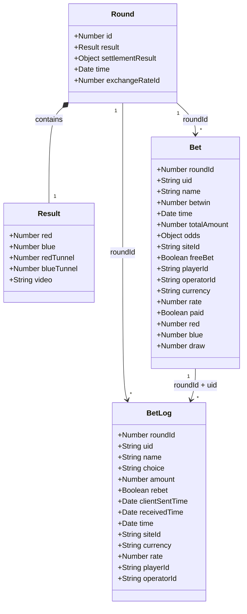
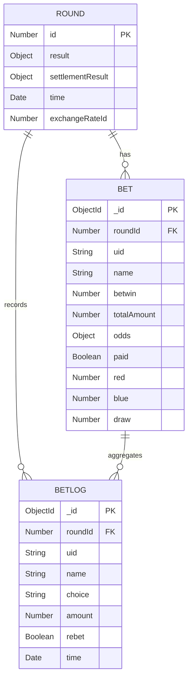
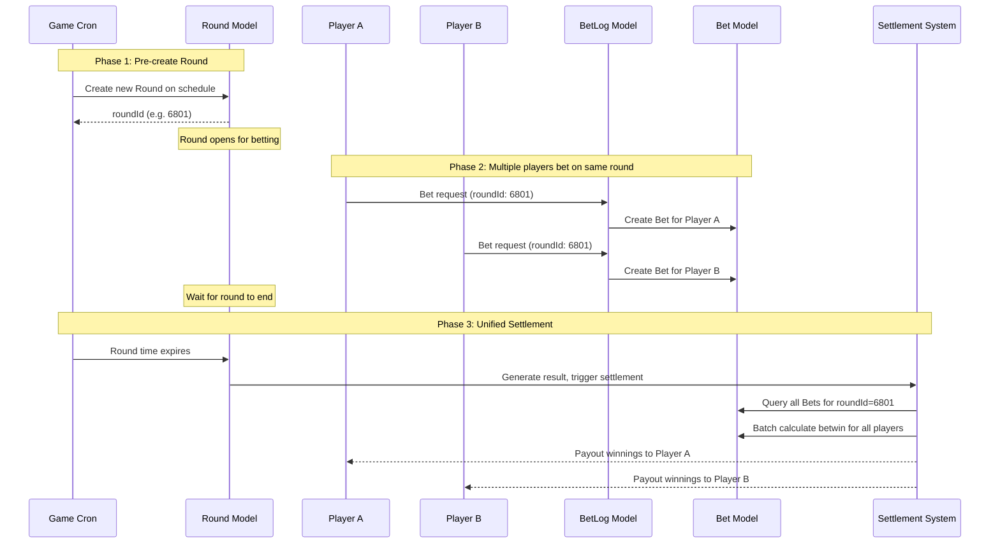
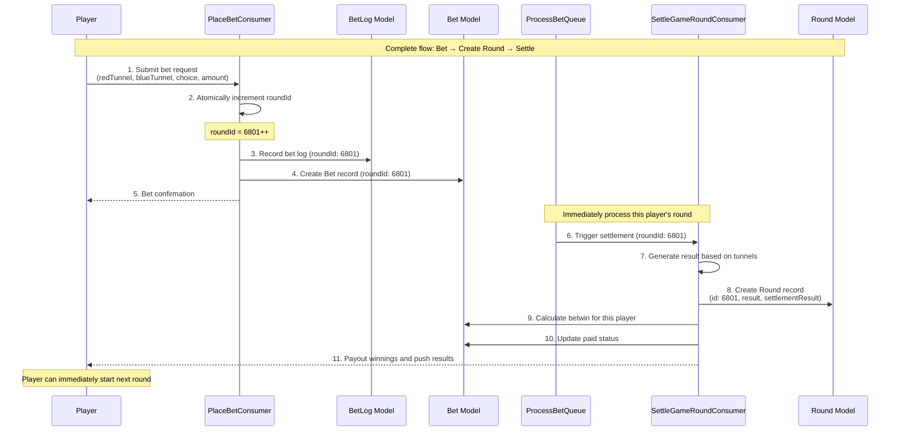

# Data Model Relationships

## Overview

This document describes the relationships between three core data models in the Soccer Pingoal Service:
- **Round** - Game rounds
- **Bet** - Player bets
- **BetLog** - Bet audit logs

## Model Relationship Diagrams

### UML Class Diagram



### Entity Relationship Diagram (ERD)



## Detailed Description

### 1. Round Model

**Purpose**: Stores round information and results for each game session

**Collection Name**: `soccerpingoal_rounds` (or `soccerpingoal_dev_rounds` in development environment)

**Main Fields**:

| Field | Type | Description |
|------|------|------|
| `id` | Number | Round ID (Primary Key) |
| `result` | Object | Detailed game result information |
| `result.red` | Number | Final score of red team |
| `result.blue` | Number | Final score of blue team |
| `result.redTunnel` | Number | Player-selected red team tunnel (1-6) |
| `result.blueTunnel` | Number | Player-selected blue team tunnel (1-6) |
| `result.video` | String | Game video URL |
| `settlementResult` | Object | Settlement result (boolean values for red/blue/draw) |
| `time` | Date | Round timestamp |
| `exchangeRateId` | Number | Exchange rate ID |

**Characteristics**:
- One Round can have multiple Bets
- Round stores final game results and video information
- `settlementResult` determines which bet options win

---

### 2. Bet Model

**Purpose**: Stores player bet information and settlement results for each round

**Collection Names**:
- `soccerpingoal_bets` (Main bet records)
- `soccerpingoal_tmpbets` (Temporary bet records)

**Main Fields**:

| Field | Type | Description |
|------|------|------|
| `roundId` | Number | Associated round ID (Foreign Key → Round.id) |
| `uid` | String | User ID |
| `name` | String | User name |
| `betwin` | Number | Winning amount |
| `time` | Date | Bet timestamp |
| `totalAmount` | Number | Total bet amount |
| `odds` | Object | Odds information |
| `siteId` | String | Site ID |
| `freeBet` | Boolean | Whether it's a free bet |
| `playerId` | String | Player ID |
| `operatorId` | String | Operator ID |
| `currency` | String | Currency type |
| `rate` | Number | Exchange rate |
| `paid` | Boolean | Whether paid out |
| `red` | Number | Amount bet on red team |
| `blue` | Number | Amount bet on blue team |
| `draw` | Number | Amount bet on draw |

**Relationships**:
- One Bet belongs to one Round (linked via `roundId`)
- One Bet can have multiple BetLogs (multiple bet operations by the same player in the same round)
- Bet records the accumulated bets and winning results for that player in that round

**Bet Options**:
- Players can bet on three options: `red` (red team wins), `blue` (blue team wins), `draw` (tie)
- Each option has an independent bet amount field

---

### 3. BetLog Model

**Purpose**: Records detailed logs of each individual bet operation

**Collection Name**: `soccerpingoal_betlogs` (or `soccerpingoal_dev_betlogs` in development environment)

**Main Fields**:

| Field | Type | Description |
|------|------|------|
| `roundId` | Number | Associated round ID (Foreign Key → Round.id) |
| `uid` | String | User ID |
| `name` | String | User name |
| `choice` | String | Bet choice (red/blue/draw) |
| `amount` | Number | Amount for this bet operation |
| `rebet` | Boolean | Whether it's a re-bet |
| `clientSentTime` | Date | Client send time |
| `receivedTime` | Date | Server receive time |
| `time` | Date | Bet timestamp |
| `siteId` | String | Site ID |
| `currency` | String | Currency type |
| `rate` | Number | Exchange rate |
| `playerId` | String | Player ID |
| `operatorId` | String | Operator ID |

**Relationships**:
- One BetLog belongs to one Round (linked via `roundId`)
- One BetLog is also indirectly associated with one Bet (via `roundId` + `uid` combination)
- BetLog records each independent bet operation including timestamps

**Characteristics**:
- Provides audit trail for bets
- Records timing details (client time, receive time, record time)
- Can be used to analyze player betting behavior and patterns

---

## Data Flow

### Flow Comparison: Game Base vs Soccer Pingoal

Soccer Pingoal uses a **single-player mode**, which is significantly different from the traditional Game Base multi-player shared round model.

---

### 🎮 Game Base Standard Flow (Multi-Player Mode)

**Characteristics**: Multiple players share the same round, rounds are created and settled on a schedule



**Timeline Example**:
```
00:00 - Cron creates Round 6801 (open for betting)
00:05 - Player A bets on Round 6801
00:10 - Player B bets on Round 6801
00:15 - Player C bets on Round 6801
00:30 - Round 6801 ends, unified settlement for all players
00:30 - Cron creates Round 6802 (next round starts)
```

---

### ⚽ Soccer Pingoal Flow (Single-Player Mode)

**Characteristics**: Each player gets an independent round, Round is created and settled immediately after betting



**Timeline Example**:
```
00:00 - Player A bets → Assigned roundId 6801 → Immediate settlement
00:05 - Player B bets → Assigned roundId 6802 → Immediate settlement
00:07 - Player A bets again → Assigned roundId 6803 → Immediate settlement
00:10 - Player C bets → Assigned roundId 6804 → Immediate settlement
```

---

### 🔍 Key Differences Comparison

| Feature | Game Base (Multi-Player) | Soccer Pingoal (Single-Player) |
|------|---------------------|------------------------|
| **Round Creation** | Pre-created by scheduled task | Created when player bets |
| **Round Allocation** | Multiple players share same Round | Each player gets independent Round |
| **roundId Generation** | Incremented by Cron on schedule | Atomically incremented on bet |
| **Settlement Timing** | Unified settlement after Round expires | Immediate settlement after bet |
| **Settlement Scope** | Batch settle all players in Round | Only settle single player |
| **Wait Time** | Players must wait for round to end | Immediate results after bet |
| **Concurrency** | Multiple players compete for same Round | Each player processed independently, no conflicts |
| **Tunnel Selection** | System decides uniformly | Player chooses (redTunnel, blueTunnel) |

---

## Soccer Pingoal Detailed Flow Description

Based on the single-player mode described above, here are the detailed steps:

### 1. Bet Request Processing (PlaceBetConsumer)

**Flow**:
```
Player submits bet → Atomically increment roundId → Validate params → Create BetLog → Create Bet
```

**Steps**:
1. Player submits bet request containing:
   - `redTunnel` (1-6): Player-selected red team tunnel
   - `blueTunnel` (1-6): Player-selected blue team tunnel
   - `choice` (red/blue/draw): Predicted outcome
   - `amount`: Bet amount

2. **PlaceBetConsumer** immediately atomically increments `roundId`:
   ```typescript
   this.gameData.roundId = (this.gameData.roundId || 0) + 1;
   ```

3. Validate bet parameters:
   - Check that `redTunnel` and `blueTunnel` are in 1-6 range
   - Check that the two tunnels are different
   - Check that `choice` is a valid option
   - Check that the game is enabled (`configs.enabled`)

4. Create **BetLog** record:
   - Record `roundId`, `uid`, `choice`, `amount`
   - Record timestamps (`clientSentTime`, `receivedTime`, `time`)

5. Create or update **Bet** record:
   - If first bet: Create new Bet record
   - If bet already exists: Accumulate amount for the corresponding option

**Related Files**:
- `src/event-consumers/place-bet-consumer.ts`
- `src/models/bet-logs.ts`
- `src/models/bets.ts`

### 2. Immediate Settlement Processing (SettleGameRoundConsumer)

**Flow**:
```
Trigger settlement → Generate result → Create Round → Calculate betwin → Payout winnings
```

**Steps**:
1. **ProcessBetQueue** immediately triggers settlement after processing bet

2. **SettleGameRoundConsumer** generates game result:
   - Based on player-selected `redTunnel` and `blueTunnel`
   - Based on `roundId`, select corresponding video from pre-recorded video library
   - Generate `result`:
     ```typescript
     {
       red: 2,           // Red team score
       blue: 1,          // Blue team score
       redTunnel: 3,     // Player-selected red team tunnel
       blueTunnel: 5,    // Player-selected blue team tunnel
       video: "https://..." // Video URL
     }
     ```

3. Calculate `settlementResult` based on scores:
   - If `red > blue`: `{ red: true, blue: false, draw: false }`
   - If `blue > red`: `{ red: false, blue: true, draw: false }`
   - If `red === blue`: `{ red: false, blue: false, draw: true }`

4. **Create Round record** (only created at this point):
   ```typescript
   await roundsRepository.create({
     id: roundId,
     result,
     settlementResult,
     time: new Date(),
     exchangeRateId: exchangeRates.exId
   });
   ```

5. Query the player's **Bet** record for this round

6. Calculate winning amount `betwin`:
   - Based on player's bet option (`red`/`blue`/`draw`)
   - Based on corresponding `odds`
   - Example: Player bets `red: 100`, odds `2.5`, and red team wins → `betwin = 100 × 2.5 = 250`

7. Update Bet's `paid` status to `true`

8. Payout winnings to player (call wallet service)

9. Push settlement results to player:
   ```typescript
   roundResultPublisher.publishToUser(playerUID, { 
     finish: { roundId, result, settlementResult, time } 
   });
   ```

**Related Files**:
- `src/event-consumers/settle-game-round-consumer.ts`
- `src/helpers/result-helper.ts`
- `src/crons/process-bet-queue.ts`
- `src/models/rounds.ts`

### 3. Concurrency Handling Mechanism

**Advantages of Single-Player Mode**:
- ✅ Each player gets independent `roundId`, no need to wait for other players
- ✅ Atomic increment ensures `roundId` uniqueness
- ✅ Each round is settled immediately, no batch processing needed
- ✅ Players can bet continuously and rapidly, unaffected by other players

**Concurrency Example**:
```
Time T1: Player A bets → roundId 6801 → Immediate settlement
Time T2: Player B bets → roundId 6802 → Immediate settlement
Time T3: Player A bets again → roundId 6803 → Immediate settlement
Time T4: Player C bets → roundId 6804 → Immediate settlement
```

Each player's betting flow is completely independent with no interference.

---

## Legacy Flow Description (Game Base Multi-Player Mode)

### 1. Round Creation Flow

```
Scheduled task triggers → Generate roundId → Select video → Create Round → Open for betting
```

1. **Game Cron** scheduled task checks if new round needs to be created
2. System generates new `roundId` (incremented)
3. Based on tunnel combination (redTunnel, blueTunnel), select corresponding video from library
4. Create new **Round** record:
   - Set `id` (roundId)
   - Set `time` (round start time)
   - Set `exchangeRateId` (exchange rate ID)
   - `result` and `settlementResult` are initially empty
5. Round status changes to "open for betting"
6. Broadcast event to notify frontend that new round has started

**Related Files**:
- `src/crons/game-cron.ts` - Scheduled round creation
- `src/models/rounds.ts` - Round model

### 2. Betting Flow (Game Base)

```
Player bets → Validate Round → Create BetLog → Update or create Bet → Wait for Round to end
```

1. Player submits bet request (choose red/blue/draw, specify amount)
2. System validates:
   - Whether the **Round** exists and is open for betting
   - Whether player has sufficient balance
   - Whether bet amount meets restrictions
3. System creates a **BetLog** record for this bet operation:
   - Record `roundId`, `uid`, `choice`, `amount`
   - Record timestamps (`clientSentTime`, `receivedTime`, `time`)
4. System updates or creates the player's **Bet** record for this round:
   - If first bet: Create new Bet record
   - If bet already exists: Accumulate amount for corresponding option (`red`/`blue`/`draw`)
   - Update `totalAmount`
5. Wait for the **Round** to end and generate results

### 3. Settlement Flow (Game Base)

```
Round ends → Generate result → Calculate settlementResult → Update Bet.betwin → Batch payout winnings
```

1. **Round** ends, **Game Cron** triggers settlement flow
2. System generates `result` based on video:
   - `red`: Red team final score
   - `blue`: Blue team final score
   - `redTunnel`: Red team tunnel selection (1-6)
   - `blueTunnel`: Blue team tunnel selection (1-6)
   - `video`: Game video URL
3. Calculate `settlementResult` based on scores:
   - If `red > blue`: `{ red: true, blue: false, draw: false }`
   - If `blue > red`: `{ red: false, blue: true, draw: false }`
   - If `red === blue`: `{ red: false, blue: false, draw: true }`
4. Update **Round** record (save `result` and `settlementResult`)
5. Query all **Bet** records for this round
6. Calculate winning amount `betwin` for each Bet:
   - Based on player's bet option and corresponding `odds`
   - Example: Player bets `red: 100`, odds `2.5`, and red team wins → `betwin = 100 × 2.5 = 250`
7. Batch update all Bets' `paid` status
8. Batch payout winnings to all winning players (call wallet service)
9. Broadcast settlement result event to all players

---

## Query Examples

### Query all bets for a round

```javascript
// Query Round
const round = await Round.findOne({ id: roundId });

// Query all Bets for the round
const bets = await Bet.find({ roundId: roundId });

// Query all BetLogs for the round
const betLogs = await BetLog.find({ roundId: roundId });
```

### Query a player's bets for a round

```javascript
// Query player's Bet
const playerBet = await Bet.findOne({ 
  roundId: roundId, 
  uid: playerId 
});

// Query player's all BetLogs
const playerBetLogs = await BetLog.find({ 
  roundId: roundId, 
  uid: playerId 
});
```

### Calculate total bets for a round

```javascript
const totalBets = await Bet.aggregate([
  { $match: { roundId: roundId } },
  { 
    $group: { 
      _id: null, 
      totalAmount: { $sum: '$totalAmount' },
      totalRedBets: { $sum: '$red' },
      totalBlueBets: { $sum: '$blue' },
      totalDrawBets: { $sum: '$draw' }
    } 
  }
]);
```

---

## Key Design Points

### 1. Why do we need both Bet and BetLog models?

- **BetLog**: Records detailed history of each bet operation (audit log)
  - Advantage: Complete bet history tracking
  - Purpose: Auditing, analysis, debugging

- **Bet**: Aggregates a player's bet information for a round
  - Advantage: Fast settlement result queries, avoids repeated calculations
  - Purpose: Settlement, display player bet status

### 2. Importance of roundId

- `roundId` is the core relational field between the three models
- Through `roundId`, the complete flow from bet to settlement can be traced
- All queries and statistics rely on `roundId` for grouping and filtering

### 3. Data Consistency

- Bet's `totalAmount` should equal the sum of all BetLog `amount` values for that player in that round
- Bet's `red`/`blue`/`draw` should equal the sum of all BetLog `amount` values for that player choosing the corresponding option
- Round's `settlementResult` determines which Bets win

---

## Summary

| Model | Primary Key | Granularity | Main Purpose |
|------|------|------|----------|
| **Round** | `id` | Per game session | Store game results and video |
| **Bet** | `_id` (MongoDB) | Per player per round | Aggregate bet amounts and settlement results |
| **BetLog** | `_id` (MongoDB) | Per bet operation | Record bet history and audit trail |

**Relationship Logic**:
```
Round (1:N) → Bet (1:N) → BetLog
```

This design balances:
- ✅ Complete bet history tracking (BetLog)
- ✅ Efficient settlement queries (Bet)
- ✅ Clear data structure (Round)

