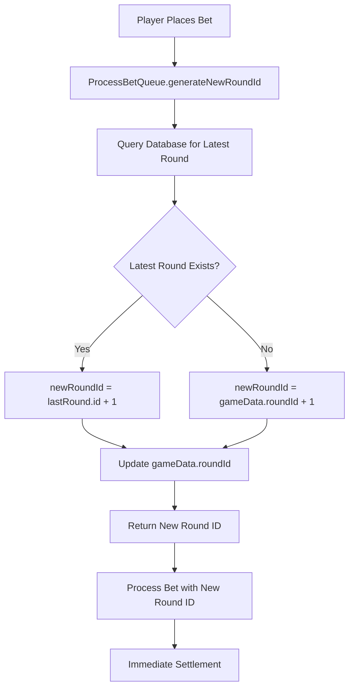
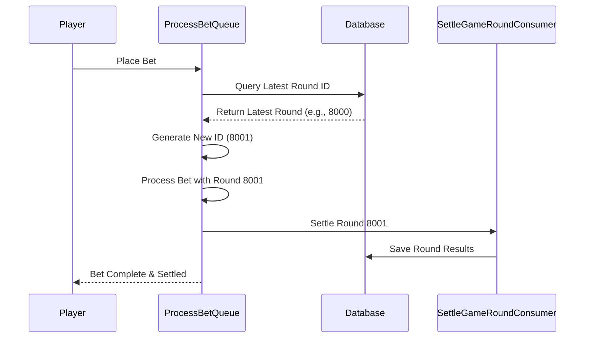

# Round Implementation Guide - Soccer Pingoal Service

## Overview

This document describes the round management implementation for the Soccer Pingoal service, which operates in **single-player mode** where each bet receives a unique round ID and is processed independently.

## Architecture Overview

### Single-Player Round Model
Unlike traditional multiplayer games where multiple players share the same round, this implementation follows a **single-player approach**:

- ✅ Each bet gets a unique `roundId`
- ✅ Each round is settled immediately after betting
- ✅ Multiple players can bet concurrently without interfering with each other
- ✅ No waiting for other players to complete their bets

## Core Components

### 1. ProcessBetQueue (`src/crons/process-bet-queue.ts`)

The main class responsible for managing round IDs and bet processing.

```typescript
export default class ProcessBetQueue extends Core.Crons.ProcessBetQueue {
    private settleGameRoundConsumer: SettleGameRoundConsumer;
    private roundsRepository: any; // Reference to rounds repository
}
```

### 2. Round Data Structure (`src/models/rounds.ts`)

```typescript
export interface IRound {
    id: number;                    // Unique round identifier
    result: {
        red: number;               // Red team final score
        blue: number;              // Blue team final score
        redTunnel: number;         // Player's selected red tunnel (1-6) - from place bet
        blueTunnel: number;        // Player's selected blue tunnel (1-6) - from place bet
        video: string;             // Game video URL
    };
    settlementResult: Record<string, boolean>; // Settlement outcomes ("blue", "red", "draw")
    time: Date;                    // Round timestamp
    exchangeRateId: number;        // Exchange rate reference
}
```

**Important Note**: The `redTunnel` and `blueTunnel` in the round result represent the **player's tunnel selections** from their place bet request, not the actual game outcome tunnels.

### 3. Bet Payload Interface

```typescript
interface BetPayload {
    amount: number;
    betChoice: string;             // "blue", "red", or "draw"
    freeBet: boolean;
    roundId: number;               // Unique round ID for each bet
    mode: string;
    receivedTime: Date;
    redTunnel: number;             // Player's red tunnel selection (1-6)
    blueTunnel: number;            // Player's blue tunnel selection (1-6)
}
```

**Data Flow**: The `redTunnel` and `blueTunnel` from the bet payload are stored in the round's result object, representing what the player selected for this specific round.

## Round ID Generation Flow

### 1. Automatic Round ID Generation



### 2. Implementation Details

```typescript
/**
 * Generate a new unique roundId for each bet (single-player style)
 * Each bet gets its own round ID, allowing concurrent independent betting
 */
private async generateNewRoundId(): Promise<number> {
    // Get the latest round from database
    const lastRound = await this.roundsRepository
        .findOne({}, "id", { sort: { id: -1 } })
        .lean()
        .exec();
    
    if (lastRound) {
        // Increment from the latest database round ID
        const newRoundId = lastRound.id + 1;
        this.gameData.roundId = newRoundId;
        console.log(`Generated new round ID: ${newRoundId}`);
        return newRoundId;
    } else {
        // If no rounds exist, increment from current gameData
        this.gameData.roundId += 1;
        console.log(`Generated new round ID: ${this.gameData.roundId}`);
        return this.gameData.roundId;
    }
}
```

## Concurrent Betting Scenarios

### Example: 3 Players Betting Simultaneously

| Time | Player | Action | Round ID | Result |
|------|--------|--------|----------|---------|
| T1 | Alice | Places bet | 8001 | Settled immediately |
| T2 | Bob | Places bet | 8002 | Settled immediately |
| T3 | Carol | Places bet | 8003 | Settled immediately |

Each player gets their own independent round, ensuring no conflicts or waiting.

## Bet Processing Workflow

### 1. Bet Reception and Round Assignment

```typescript
/**
 * Handle successful bet processing and immediate settlement
 * In single-player mode, each bet is settled independently and immediately
 */
async handleSuccessBet(player: Player, balance: unknown, roundId: number, bet: BetPayload) {
    await super.handleSuccessBet(player, balance, roundId, bet);

    console.log(`Successful bet by ${player.profile.name} on round ${roundId}`);

    // For single-player style, each bet gets its own round and should be settled immediately
    try {
        await this.settleGameRoundConsumer.settleRound();
        console.log(`Settlement completed for round ${roundId}`);
    } catch (error) {
        console.error(`Settlement failed for round ${roundId}:`, error);
        // Note: Settlement failure shouldn't affect the bet processing result
        // Consider implementing a retry mechanism or queuing system for failed settlements
    }
}
```

### 2. Settlement Process

1. **Immediate Settlement**: Each bet is settled right after successful processing
2. **Independent Rounds**: No dependency on other players' actions
3. **Error Handling**: Settlement failures are logged but don't affect bet processing

## Database Synchronization

### 1. Round ID Consistency

- **Database Query**: Always fetch the latest round ID from database
- **Atomic Operations**: Each round ID generation is atomic to prevent conflicts
- **Auto-increment**: Round IDs automatically increment from the last known value

### 2. Data Flow



## API Usage

### 1. Generate New Round ID

```typescript
// Method 1: For new bet preparation
const newRoundId = await processBetQueue.prepareNewRoundForBet();

// Method 2: Direct round ID generation
const roundId = await processBetQueue.getNewRoundForBetting();
```

### 2. Access Current Round ID (PlaceBetConsumer)

```typescript
// In PlaceBetConsumer validation
validateBetRequestParams(request: any) {
    // Get current round ID - automatically managed
    const currentRoundId = this.gameData.roundId;
    
    // Use for validation or logging
    console.log(`Processing bet for round: ${currentRoundId}`);
    
    // Your validation logic...
}
```

## Validation Integration

### Place Bet Validation with Round Context

The `PlaceBetConsumer` validates bet parameters including:

```typescript
validateBetRequestParams(request: any) {
    const { betChoice, amount, redTunnel, blueTunnel } = request;
    const currentRoundId = this.gameData.roundId;
    
    return [
        // Amount validation
        { failure: !amount || amount <= 0, notice: ... },
        
        // BetChoice validation (must be "blue", "red", or "draw")
        { failure: !validBetChoices.includes(betChoice), notice: ... },
        
        // Tunnel validations (1-6 range, different values)
        { failure: redTunnel < 1 || redTunnel > 6, notice: ... },
        { failure: blueTunnel < 1 || blueTunnel > 6, notice: ... },
        { failure: redTunnel === blueTunnel, notice: ... }
    ];
}
```

## Server Startup and Initialization

### Round ID Initialization on Server Start

```typescript
// From game-cron.ts and round-id-consumer.js
async start() {
    await this.roundIdConsumer.initRoundId();  // Initialize from database
    
    // Set initial round ID if first time
    if (this.gameData.roundId === 1) {
        const firstRoundId = 6800;
        this.gameData.roundId = firstRoundId;
    }
    
    await this.getSettingForNewRound();
    await this.updateExchangeRates();
    this.startCron();
}
```

**Initialization Process:**
1. Query database for the latest round ID
2. Set `gameData.roundId = lastRound.id + 1`
3. If no historical data exists, use default starting value (e.g., 6800)

## Error Handling and Edge Cases

### 1. Database Connection Issues

```typescript
// Fallback to gameData increment if database query fails
if (lastRound) {
    const newRoundId = lastRound.id + 1;
    this.gameData.roundId = newRoundId;
} else {
    // Fallback: increment from current gameData
    this.gameData.roundId += 1;
}
```

### 2. Settlement Failures

```typescript
try {
    await this.settleGameRoundConsumer.settleRound();
    console.log(`Settlement completed for round ${roundId}`);
} catch (error) {
    console.error(`Settlement failed for round ${roundId}:`, error);
    // Note: Settlement failure shouldn't affect the bet processing result
    // Consider implementing a retry mechanism or queuing system for failed settlements
}
```

## Performance Considerations

### 1. Concurrent Safety

- **Atomic Operations**: Each round ID generation is atomic
- **Database Queries**: Optimized with indexes on round ID fields
- **Memory Efficiency**: Minimal in-memory state tracking

### 2. Scalability

- **Independent Processing**: Each bet processes independently
- **No Blocking**: Players don't wait for others
- **Database Scaling**: Can handle high concurrent read/write operations

## Monitoring and Logging

### 1. Round Generation Logs

```typescript
console.log(`Generated new round ID: ${newRoundId}`);
console.log(`Prepared new round ID: ${newRoundId} for incoming bet`);
console.log(`Successful bet by ${player.profile.name} on round ${roundId}`);
console.log(`Settlement completed for round ${roundId}`);
```

### 2. Key Metrics to Monitor

- **Round ID Progression**: Ensure continuous increment
- **Settlement Success Rate**: Track settlement failures
- **Concurrent Bet Processing**: Monitor simultaneous bet handling
- **Database Performance**: Query response times for round ID generation

## Best Practices

### 1. Development

- Always test concurrent betting scenarios
- Verify round ID uniqueness across simultaneous requests
- Test database connection failure scenarios
- Implement proper error logging and monitoring

### 2. Deployment

- Monitor round ID progression after deployment
- Set up alerts for settlement failures
- Verify database performance under load
- Test server restart recovery

### 3. Maintenance

- Regular database cleanup of old rounds (if needed)
- Monitor database growth and performance
- Review and optimize round ID generation queries
- Keep settlement retry mechanisms updated

## Conclusion

This single-player round implementation provides:

- **Independence**: Each player gets their own gaming experience
- **Concurrency**: Multiple players can bet simultaneously without conflicts
- **Reliability**: Robust error handling and database synchronization
- **Scalability**: Can handle high concurrent betting loads
- **Simplicity**: Clear and maintainable code structure

The implementation ensures that each bet is treated as an individual game round, providing immediate feedback and settlement without dependencies on other players' actions.
