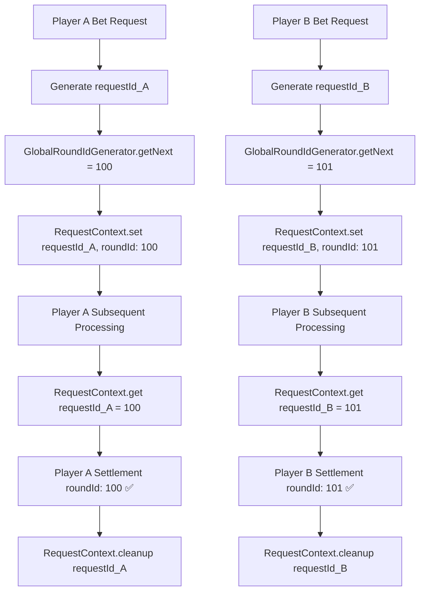

# RoundID Context Solution

## 🎯 **Problem Description**

The current system has concurrency safety issues:
- Player A places a bet and gets assigned `roundId = 100`, stored in `this.gameData.roundId`
- While Player A's request is still being processed, Player B places a bet and changes `this.gameData.roundId` to `101`
- When Player A's subsequent processing (like settlement) reads `this.gameData.roundId`, it incorrectly gets `101` instead of the originally assigned `100`

## 💡 **Solution: Request Context**

Use request context to isolate each player's roundId, avoiding concurrency issues caused by shared state.

### **Core Concepts**
1. **Don't modify `this.gameData.roundId`** - Avoid shared state contamination
2. **Use static global counter** - Generate unique roundId
3. **Context storage** - Bind roundId to specific request context
4. **Method signatures unchanged** - No need to pass roundId parameters everywhere

## 🏗️ **Architecture Design**

### **1. Request Context Manager**

```typescript
// src/utils/request-context.ts (new file)
export class RequestContext {
    private static storage = new Map<string, any>();
    
    static setRoundId(requestId: string, roundId: number): void {
        this.storage.set(`${requestId}_roundId`, roundId);
        console.log(`Context: Set roundId ${roundId} for request ${requestId}`);
    }
    
    static getRoundId(requestId: string): number | undefined {
        const roundId = this.storage.get(`${requestId}_roundId`);
        console.log(`Context: Get roundId ${roundId} for request ${requestId}`);
        return roundId;
    }
    
    static setRequestData(requestId: string, key: string, value: any): void {
        this.storage.set(`${requestId}_${key}`, value);
    }
    
    static getRequestData(requestId: string, key: string): any {
        return this.storage.get(`${requestId}_${key}`);
    }
    
    static cleanup(requestId: string): void {
        // Clean up all data related to this request
        const keysToDelete = [];
        for (const key of this.storage.keys()) {
            if (key.startsWith(`${requestId}_`)) {
                keysToDelete.push(key);
            }
        }
        keysToDelete.forEach(key => this.storage.delete(key));
        console.log(`Context: Cleaned up ${keysToDelete.length} items for request ${requestId}`);
    }
    
    static getAllActiveRequests(): string[] {
        const requestIds = new Set<string>();
        for (const key of this.storage.keys()) {
            const requestId = key.split('_')[0];
            requestIds.add(requestId);
        }
        return Array.from(requestIds);
    }
}
```

### **2. RoundId Generator Interface & Implementation (DI Pattern)**

```typescript
// src/utils/request-context.ts (continued)

// Interface for different game round ID generation strategies
export interface IRoundIdGenerator {
    getNextRoundId(): number;
    initializeFrom(startingId: number): void;
    getCurrentRoundId(): number;
}

// Default implementation for Soccer Pingoal game
export class SoccerPingoalRoundIdGenerator implements IRoundIdGenerator {
    private currentRoundId: number = 0;
    
    getNextRoundId(): number {
        this.currentRoundId++;
        console.log(`[SoccerPingoal] Generated new roundId: ${this.currentRoundId}`);
        return this.currentRoundId;
    }
    
    initializeFrom(startingId: number): void {
        this.currentRoundId = startingId;
        console.log(`[SoccerPingoal] Initialized roundId counter from: ${startingId}`);
    }
    
    getCurrentRoundId(): number {
        return this.currentRoundId;
    }
}

// Enhanced RequestContext with DI support
export class RequestContext {
    private static storage = new Map<string, any>();
    private static roundIdGenerator: IRoundIdGenerator;
    
    // DI setter for round ID generator
    static setRoundIdGenerator(generator: IRoundIdGenerator): void {
        this.roundIdGenerator = generator;
        console.log(`Context: Set RoundId generator to ${generator.constructor.name}`);
    }
    
    static getRoundIdGenerator(): IRoundIdGenerator {
        if (!this.roundIdGenerator) {
            throw new Error('RoundIdGenerator not initialized. Please call setRoundIdGenerator() first.');
        }
        return this.roundIdGenerator;
    }
    
    static setRoundId(requestId: string, roundId: number): void {
        this.storage.set(`${requestId}_roundId`, roundId);
        console.log(`Context: Set roundId ${roundId} for request ${requestId}`);
    }
    
    static getRoundId(requestId: string): number | undefined {
        const roundId = this.storage.get(`${requestId}_roundId`);
        console.log(`Context: Get roundId ${roundId} for request ${requestId}`);
        return roundId;
    }
    
    static setRequestData(requestId: string, key: string, value: any): void {
        this.storage.set(`${requestId}_${key}`, value);
    }
    
    static getRequestData(requestId: string, key: string): any {
        return this.storage.get(`${requestId}_${key}`);
    }
    
    static cleanup(requestId: string): void {
        // Clean up all data related to this request
        const keysToDelete = [];
        for (const key of this.storage.keys()) {
            if (key.startsWith(`${requestId}_`)) {
                keysToDelete.push(key);
            }
        }
        keysToDelete.forEach(key => this.storage.delete(key));
        console.log(`Context: Cleaned up ${keysToDelete.length} items for request ${requestId}`);
    }
    
    static getAllActiveRequests(): string[] {
        const requestIds = new Set<string>();
        for (const key of this.storage.keys()) {
            const requestId = key.split('_')[0];
            requestIds.add(requestId);
        }
        return Array.from(requestIds);
    }
}
```

## 🔧 **Detailed File Modification Plan**

### **1. src/event-consumers/place-bet-consumer.ts**

```typescript
import { RequestContext, IRoundIdGenerator } from '../utils/request-context';

export default class PlaceBetConsumer extends Core.BaseEventConsumers.PlaceBetConsumer {
    
    private generateRequestId(): string {
        // Generate unique request ID
        return `req_${Date.now()}_${Math.random().toString(36).substr(2, 9)}`;
    }

    validateBetRequestParams(request: any) {
        // Generate unique request ID and roundId using DI generator
        const requestId = this.generateRequestId();
        const roundIdGenerator = RequestContext.getRoundIdGenerator();
        const assignedRoundId = roundIdGenerator.getNextRoundId();
        
        // Store in Context (don't modify this.gameData.roundId)
        RequestContext.setRoundId(requestId, assignedRoundId);
        
        // Attach request ID to request object for subsequent use
        request._requestId = requestId;
        request._assignedRoundId = assignedRoundId; // as fallback
        
        const { redTunnel, blueTunnel } = request;
        
        console.log(`Processing bet validation for round ${assignedRoundId} (request: ${requestId}) with tunnels: red=${redTunnel}, blue=${blueTunnel}`);

        return [
            // Use parent's basic amount and betChoice validation
            ...super.validateBetRequestParams(request),
            // ... existing validation logic remains unchanged
        ];
    }
}
```

### **2. src/event-consumers/settle-game-round-consumer.ts**

```typescript
import { RequestContext } from '../utils/request-context';

export default class SettleGameRoundConsumer extends Core.BaseEventConsumers.SettleGameRoundConsumer {
    private currentRequestId: string | null = null;
    
    async settleRoundWithSelections(selections: PlayerTunnelSelections, playerInfo?: PlayerInfo, requestId?: string): Promise<void> {
        this.currentPlayerSelections = selections;
        this.currentPlayerInfo = playerInfo || null;
        this.currentRequestId = requestId || null;
        
        console.log(`Starting settlement for request: ${this.currentRequestId}`);
        
        try {
            await this.settleRound();
        } finally {
            // Clean up request-related data
            if (this.currentRequestId) {
                RequestContext.cleanup(this.currentRequestId);
                this.currentRequestId = null;
            }
            this.currentPlayerSelections = null;
            this.currentPlayerInfo = null;
        }
    }

    async settleRound(): Promise<void> {
        const result = this.generateResult();
        const settlementResult = (this.definition as any).settle(result);
        
        // Get roundId from Context, not from this.gameData.roundId
        const roundId = this.currentRequestId ? 
            RequestContext.getRoundId(this.currentRequestId) : 
            this.gameData.roundId; // fallback
        
        const { exchangeRates } = this.gameData;
        
        // Validate required fields
        if (!roundId) {
            throw new Error('roundId is required but not available in context');
        }
        
        if (!exchangeRates || !exchangeRates.exId) {
            throw new Error('exchangeRates.exId is required but not available');
        }
        
        console.log(`Creating round in database with ID: ${roundId}, exchangeRateId: ${exchangeRates.exId}`);
        
        const newRound = await (this as any).roundsRepository.create({
            id: roundId,
            result,
            settlementResult,
            time: new Date(),
            exchangeRateId: exchangeRates.exId,
        });

        if (newRound) {
            // Use roundId from Context when publishing results
            (this as any).roundResultPublisher?.publishRoundResult(
                (this as any).collectRoundResult(result, settlementResult, roundId)
            );

            (this as any).roundWinnersPublisher?.publishWinners({
                result,
                roundId: newRound.id,
                time: newRound.time,
            });

            console.log(`Round ${roundId} settled successfully using context-based roundId`);
            
            (this as any).roundResultPublisher?.publishWinners(roundId, this.gameData.winningPlayers);
        }
    }

    generateResult() {
        // Get roundId from Context for result generation
        const roundId = this.currentRequestId ? 
            RequestContext.getRoundId(this.currentRequestId) : 
            this.gameData.roundId; // fallback
            
        console.log(`Generating result for round ${roundId} with player tunnel selections (context-based)`);
        
        return generateResult(
            this.currentPlayerSelections, 
            roundId,  // Use roundId from Context
            this.gameData,
            this.currentPlayerInfo?.nickname
        );
    }
}
```

### **3. src/crons/process-bet-queue.ts**

```typescript
export default class ProcessBetQueue extends Core.Crons.ProcessBetQueue {
    async handleSuccessBet(player: Player, balance: unknown, roundId: number, bet: BetPayload) {
        await super.handleSuccessBet(player, balance, roundId, bet);

        // Use roundId from request (passed through parameter)
        const requestId = bet._requestId;
        const contextRoundId = requestId ? RequestContext.getRoundId(requestId) : roundId;
        
        console.log(`Successful bet by ${player.profile.name} on round ${contextRoundId} (request: ${requestId})`);

        try {
            // Pass requestId to settlement method
            await this.settleGameRoundConsumer.settleRoundWithSelections(
                {
                    redTunnel: bet.redTunnel,
                    blueTunnel: bet.blueTunnel
                },
                {
                    nickname: player.profile.name
                },
                requestId  // Pass requestId to settlement method
            );
            console.log(`Settlement completed for round ${contextRoundId} with player tunnel selections: red=${bet.redTunnel}, blue=${bet.blueTunnel}, player=${player.profile.name}`);
        } catch (error) {
            console.error(`Settlement failed for round ${contextRoundId}:`, error);
            // Ensure Context cleanup even if failure occurs
            if (requestId) {
                RequestContext.cleanup(requestId);
            }
        }
    }
}
```

### **4. src/crons/game-cron.ts**

```typescript
import { RequestContext, IRoundIdGenerator } from '../utils/request-context';

export default class GameCron extends Core.Crons.BaseGameCron {
    private readonly roundIdGenerator: IRoundIdGenerator;

    constructor(dependencies: any) {
        super(dependencies);
        // Get injected roundId generator
        this.roundIdGenerator = dependencies.roundIdGenerator;
    }

    async start() {
        await this.roundIdConsumer.initRoundId();

        // Initialize the injected roundId generator and set it in Context
        const currentRoundId = this.gameData.roundId || 6800;
        this.roundIdGenerator.initializeFrom(currentRoundId);
        
        // Set the generator in RequestContext for global access
        RequestContext.setRoundIdGenerator(this.roundIdGenerator);

        // Set initial round ID (for other potential uses, but not for allocation)
        if (this.gameData.roundId === 1) {
            const firstRoundId = 6800;
            this.gameData.roundId = firstRoundId;
            this.roundIdGenerator.initializeFrom(firstRoundId);
        }

        await this.getSettingForNewRound();
        await this.updateExchangeRates();
        this.startCron();
    }
}
```

### **5. src/container-registry.ts (DI Registration)**

```typescript
import { asClass, asValue, AwilixContainer } from "awilix";
import { Table } from "sc-game-base";
import { GameCron, ProcessBetQueue } from "./crons";
import { InGameConsumer, PlaceBetConsumer, SettleGameRoundConsumer } from "./event-consumers";
import { betLogs, bets, rounds, tmpBets } from "./models";
import { GameStatusPublisher } from "./event-publishers";
import { RoundQuery } from "./crons/query-apis/round-query";
import { SoccerPingoalRoundIdGenerator } from "./utils/request-context";

export default class ContainerRegistry extends Table.TableContainerRegistry {
    register(appConfigs: any, definition: any, gameData: any): AwilixContainer<any> {
        super.register(appConfigs, definition, gameData);
        this.registerApis();

        return this.container;
    }

    registerApis() {
        super.registerApis();
        this.container.register({
            roundQuery: asClass(RoundQuery).singleton(),
        });
    }

    registerModels() {
        super.registerModels();

        this.container.register({
            betsRepository: asValue(bets),
            tempBetsRepository: asValue(tmpBets),
            betLogsRepository: asValue(betLogs),
            roundsRepository: asValue(rounds),
        });
    }

    registerCrons(): void {
        super.registerCrons();

        this.container.register({
            gameCron: asClass(GameCron).singleton().proxy(),
            processBetQueue: asClass(ProcessBetQueue).singleton().proxy(),
            // Register RoundId Generator for Soccer Pingoal game
            roundIdGenerator: asClass(SoccerPingoalRoundIdGenerator).singleton(),
        });
    }

    registerConsumers() {
        super.registerConsumers();

        this.container.register({
            inGameConsumer: asClass(InGameConsumer).singleton(),
            settleGameRoundConsumer: asClass(SettleGameRoundConsumer).singleton().proxy(),
            placeBetConsumer: asClass(PlaceBetConsumer).singleton(),
        });
    }

    registerPublishers() {
        super.registerPublishers();

        this.container.register({
            gameStatusPublisher: asClass(GameStatusPublisher).singleton(),
        });
    }
}
```

## 🎮 **Multi-Game Support with DI Pattern**

The DI pattern allows different games to implement their own RoundId generation strategies:

### **Example: Different Game Implementations**

```typescript
// src/utils/round-id-generators/poker-round-id-generator.ts
export class PokerRoundIdGenerator implements IRoundIdGenerator {
    private currentRoundId: number = 0;
    private gamePrefix: string = 'PKR';
    
    getNextRoundId(): number {
        this.currentRoundId++;
        const roundId = parseInt(`${Date.now().toString().slice(-6)}${this.currentRoundId.toString().padStart(3, '0')}`);
        console.log(`[Poker] Generated new roundId: ${roundId}`);
        return roundId;
    }
    
    initializeFrom(startingId: number): void {
        this.currentRoundId = startingId;
        console.log(`[Poker] Initialized roundId counter from: ${startingId}`);
    }
    
    getCurrentRoundId(): number {
        return this.currentRoundId;
    }
}

// src/utils/round-id-generators/blackjack-round-id-generator.ts  
export class BlackjackRoundIdGenerator implements IRoundIdGenerator {
    private currentRoundId: number = 0;
    
    getNextRoundId(): number {
        // Blackjack uses timestamp-based IDs for better uniqueness
        const timestamp = Date.now();
        this.currentRoundId = timestamp;
        console.log(`[Blackjack] Generated timestamp-based roundId: ${this.currentRoundId}`);
        return this.currentRoundId;
    }
    
    initializeFrom(startingId: number): void {
        // For timestamp-based, we might not use the startingId
        console.log(`[Blackjack] Using timestamp-based generation, ignoring startingId: ${startingId}`);
    }
    
    getCurrentRoundId(): number {
        return this.currentRoundId;
    }
}
```

### **Game-Specific Container Registry**

```typescript
// For different games, register different generators:

// Soccer Pingoal Game
this.container.register({
    roundIdGenerator: asClass(SoccerPingoalRoundIdGenerator).singleton(),
});

// Poker Game
this.container.register({
    roundIdGenerator: asClass(PokerRoundIdGenerator).singleton(),
});

// Blackjack Game  
this.container.register({
    roundIdGenerator: asClass(BlackjackRoundIdGenerator).singleton(),
});
```

### **Benefits of DI Approach**

1. **🎯 Game-Specific Logic**: Each game can have its unique roundId strategy
2. **🔧 Easy Testing**: Mock generators for unit tests
3. **🚀 Runtime Switching**: Could potentially switch generators based on configuration
4. **📈 Extensibility**: Add new games without modifying existing code
5. **🔒 Type Safety**: Interface ensures consistent API across all implementations

## 📊 **Data Flow Diagram**



## 🎯 **Key Advantages**

### **1. Complete Isolation**
- Each request has its own independent Context space
- Won't be affected by other concurrent requests

### **2. No Need to Modify Method Signatures**
- All existing methods remain unchanged
- Good backward compatibility

### **3. Automatic Cleanup**
- Automatically cleanup related Context when request ends
- Prevent memory leaks

### **4. Easy to Debug**
- Each request has a unique requestId
- Complete request lifecycle can be tracked in logs

### **5. Extensibility**
- Context can store more request-related information
- Can support more complex request processing logic in the future

## 🔧 **Implementation Steps**

1. **Add** `src/utils/request-context.ts` - Create RequestContext and IRoundIdGenerator interface
2. **Add** `src/utils/request-context.ts` - Implement SoccerPingoalRoundIdGenerator
3. **Modify** `src/container-registry.ts` - Register roundIdGenerator as DI dependency
4. **Modify** `src/crons/game-cron.ts` - Inject and initialize roundIdGenerator
5. **Modify** `src/event-consumers/place-bet-consumer.ts` - Use injected generator via RequestContext
6. **Modify** `src/event-consumers/settle-game-round-consumer.ts` - Use Context-based roundId
7. **Modify** `src/crons/process-bet-queue.ts` - Ensure proper Context usage
8. **Test** concurrent scenarios to ensure roundId isolation works properly
9. **Optional**: Create additional game-specific generators for other games

## 📋 **Test Scenarios**

### **Unit Tests**
- Test Context storage and retrieval
- Test IRoundIdGenerator interface implementations
- Test different generator strategies (SoccerPingoal, Poker, Blackjack)
- Test Context cleanup functionality
- Test DI injection and initialization

### **Integration Tests**  
- Simulate multi-user concurrent betting
- Verify each user gets unique roundId
- Confirm correct roundId is used during settlement
- Test generator switching for different games
- Verify RequestContext properly uses injected generator

### **Load Tests**
- RoundId allocation under high concurrency scenarios
- Context memory usage monitoring
- Long-running stability tests
- Performance comparison between different generator implementations

### **DI-Specific Tests**
```typescript
// Example test cases for DI pattern
describe('RoundId Generator DI', () => {
    test('should inject correct generator for Soccer Pingoal', () => {
        const generator = container.resolve('roundIdGenerator');
        expect(generator).toBeInstanceOf(SoccerPingoalRoundIdGenerator);
    });
    
    test('should generate unique roundIds with different generators', async () => {
        const soccerGen = new SoccerPingoalRoundIdGenerator();
        const pokerGen = new PokerRoundIdGenerator();
        
        soccerGen.initializeFrom(1000);
        pokerGen.initializeFrom(1000);
        
        const soccerId = soccerGen.getNextRoundId();
        const pokerId = pokerGen.getNextRoundId();
        
        expect(soccerId).not.toEqual(pokerId);
    });
    
    test('should handle RequestContext generator switching', () => {
        const mockGen = jest.createMockFromModule<IRoundIdGenerator>('../utils/request-context');
        RequestContext.setRoundIdGenerator(mockGen);
        
        expect(RequestContext.getRoundIdGenerator()).toBe(mockGen);
    });
});
```

## 🚀 **Summary**

This solution completely resolves the roundId concurrency safety issues by introducing Request Context mechanism with Dependency Injection pattern:

### **Core Benefits**
- **🔒 Concurrency Safety**: Don't modify shared state `this.gameData.roundId`
- **🎯 Request Isolation**: Use Context isolation for each request's data  
- **🔌 API Compatibility**: Maintain compatibility without breaking existing interfaces
- **🏗️ Clean Architecture**: Clear architectural design with DI pattern

### **DI Pattern Advantages**
- **🎮 Multi-Game Support**: Different games can implement unique roundId strategies
- **🔧 Easy Testing**: Injectable dependencies make unit testing straightforward
- **📈 High Extensibility**: Add new games without modifying existing code
- **⚡ Runtime Flexibility**: Could potentially switch generators based on configuration
- **🔒 Type Safety**: Interface ensures consistent API across all implementations

### **Production Ready**
After implementing this solution, the system will be able to:
- ✅ Safely handle multi-user concurrent betting
- ✅ Give each player a correct and unique roundId
- ✅ Support different games with their own roundId generation logic
- ✅ Scale easily to accommodate new game types
- ✅ Maintain high performance under load with proper isolation
