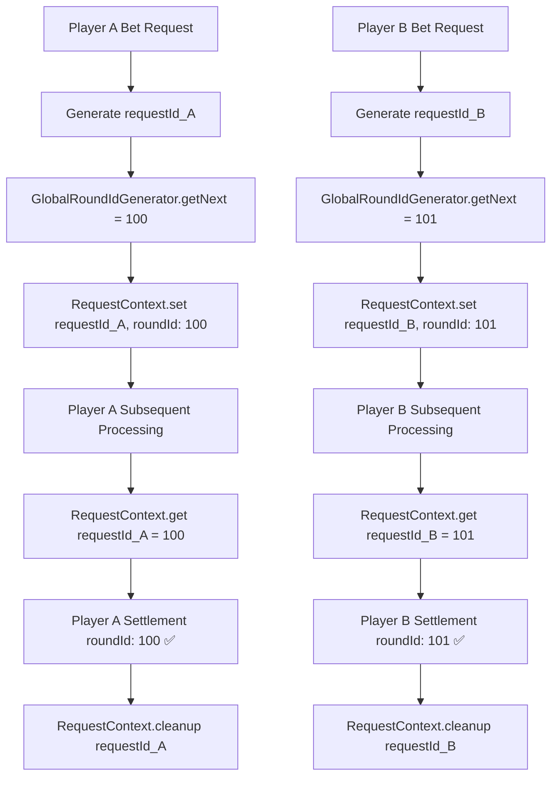

# RoundID Context Solution

## 🎯 **Problem Description**

The current system has concurrency safety issues:
- Player A places a bet and gets assigned `roundId = 100`, stored in `this.gameData.roundId`
- While Player A's request is still being processed, Player B places a bet and changes `this.gameData.roundId` to `101`
- When Player A's subsequent processing (like settlement) reads `this.gameData.roundId`, it incorrectly gets `101` instead of the originally assigned `100`

## 💡 **Solution: Request Context**

Use request context to isolate each player's roundId, avoiding concurrency issues caused by shared state.

### **Core Concepts**
1. **Don't modify `this.gameData.roundId`** - Avoid shared state contamination
2. **Use static global counter** - Generate unique roundId
3. **Context storage** - Bind roundId to specific request context
4. **Method signatures unchanged** - No need to pass roundId parameters everywhere

## 🏗️ **Architecture Design**

### **1. Request Context Manager**

```typescript
// src/utils/request-context.ts (new file)
export class RequestContext {
    private static storage = new Map<string, any>();
    
    static setRoundId(requestId: string, roundId: number): void {
        this.storage.set(`${requestId}_roundId`, roundId);
        console.log(`Context: Set roundId ${roundId} for request ${requestId}`);
    }
    
    static getRoundId(requestId: string): number | undefined {
        const roundId = this.storage.get(`${requestId}_roundId`);
        console.log(`Context: Get roundId ${roundId} for request ${requestId}`);
        return roundId;
    }
    
    static setRequestData(requestId: string, key: string, value: any): void {
        this.storage.set(`${requestId}_${key}`, value);
    }
    
    static getRequestData(requestId: string, key: string): any {
        return this.storage.get(`${requestId}_${key}`);
    }
    
    static cleanup(requestId: string): void {
        // Clean up all data related to this request
        const keysToDelete = [];
        for (const key of this.storage.keys()) {
            if (key.startsWith(`${requestId}_`)) {
                keysToDelete.push(key);
            }
        }
        keysToDelete.forEach(key => this.storage.delete(key));
        console.log(`Context: Cleaned up ${keysToDelete.length} items for request ${requestId}`);
    }
    
    static getAllActiveRequests(): string[] {
        const requestIds = new Set<string>();
        for (const key of this.storage.keys()) {
            const requestId = key.split('_')[0];
            requestIds.add(requestId);
        }
        return Array.from(requestIds);
    }
}
```

### **2. Global RoundId Generator**

```typescript
// src/utils/request-context.ts (continued)
export class GlobalRoundIdGenerator {
    private static currentRoundId: number = 0;
    
    static getNextRoundId(): number {
        this.currentRoundId++;
        console.log(`Generated new global roundId: ${this.currentRoundId}`);
        return this.currentRoundId;
    }
    
    static initializeFrom(startingId: number): void {
        this.currentRoundId = startingId;
        console.log(`Initialized global roundId counter from: ${startingId}`);
    }
    
    static getCurrentRoundId(): number {
        return this.currentRoundId;
    }
}
```

## 🔧 **Detailed File Modification Plan**

### **1. src/event-consumers/place-bet-consumer.ts**

```typescript
import { RequestContext, GlobalRoundIdGenerator } from '../utils/request-context';

export default class PlaceBetConsumer extends Core.BaseEventConsumers.PlaceBetConsumer {
    
    private generateRequestId(): string {
        // Generate unique request ID
        return `req_${Date.now()}_${Math.random().toString(36).substr(2, 9)}`;
    }

    validateBetRequestParams(request: any) {
        // Generate unique request ID and roundId
        const requestId = this.generateRequestId();
        const assignedRoundId = GlobalRoundIdGenerator.getNextRoundId();
        
        // Store in Context (don't modify this.gameData.roundId)
        RequestContext.setRoundId(requestId, assignedRoundId);
        
        // Attach request ID to request object for subsequent use
        request._requestId = requestId;
        request._assignedRoundId = assignedRoundId; // as fallback
        
        const { redTunnel, blueTunnel } = request;
        
        console.log(`Processing bet validation for round ${assignedRoundId} (request: ${requestId}) with tunnels: red=${redTunnel}, blue=${blueTunnel}`);

        return [
            // Use parent's basic amount and betChoice validation
            ...super.validateBetRequestParams(request),
            // ... existing validation logic remains unchanged
        ];
    }
}
```

### **2. src/event-consumers/settle-game-round-consumer.ts**

```typescript
import { RequestContext } from '../utils/request-context';

export default class SettleGameRoundConsumer extends Core.BaseEventConsumers.SettleGameRoundConsumer {
    private currentRequestId: string | null = null;
    
    async settleRoundWithSelections(selections: PlayerTunnelSelections, playerInfo?: PlayerInfo, requestId?: string): Promise<void> {
        this.currentPlayerSelections = selections;
        this.currentPlayerInfo = playerInfo || null;
        this.currentRequestId = requestId || null;
        
        console.log(`Starting settlement for request: ${this.currentRequestId}`);
        
        try {
            await this.settleRound();
        } finally {
            // Clean up request-related data
            if (this.currentRequestId) {
                RequestContext.cleanup(this.currentRequestId);
                this.currentRequestId = null;
            }
            this.currentPlayerSelections = null;
            this.currentPlayerInfo = null;
        }
    }

    async settleRound(): Promise<void> {
        const result = this.generateResult();
        const settlementResult = (this.definition as any).settle(result);
        
        // Get roundId from Context, not from this.gameData.roundId
        const roundId = this.currentRequestId ? 
            RequestContext.getRoundId(this.currentRequestId) : 
            this.gameData.roundId; // fallback
        
        const { exchangeRates } = this.gameData;
        
        // Validate required fields
        if (!roundId) {
            throw new Error('roundId is required but not available in context');
        }
        
        if (!exchangeRates || !exchangeRates.exId) {
            throw new Error('exchangeRates.exId is required but not available');
        }
        
        console.log(`Creating round in database with ID: ${roundId}, exchangeRateId: ${exchangeRates.exId}`);
        
        const newRound = await (this as any).roundsRepository.create({
            id: roundId,
            result,
            settlementResult,
            time: new Date(),
            exchangeRateId: exchangeRates.exId,
        });

        if (newRound) {
            // Use roundId from Context when publishing results
            (this as any).roundResultPublisher?.publishRoundResult(
                (this as any).collectRoundResult(result, settlementResult, roundId)
            );

            (this as any).roundWinnersPublisher?.publishWinners({
                result,
                roundId: newRound.id,
                time: newRound.time,
            });

            console.log(`Round ${roundId} settled successfully using context-based roundId`);
            
            (this as any).roundResultPublisher?.publishWinners(roundId, this.gameData.winningPlayers);
        }
    }

    generateResult() {
        // Get roundId from Context for result generation
        const roundId = this.currentRequestId ? 
            RequestContext.getRoundId(this.currentRequestId) : 
            this.gameData.roundId; // fallback
            
        console.log(`Generating result for round ${roundId} with player tunnel selections (context-based)`);
        
        return generateResult(
            this.currentPlayerSelections, 
            roundId,  // Use roundId from Context
            this.gameData,
            this.currentPlayerInfo?.nickname
        );
    }
}
```

### **3. src/crons/process-bet-queue.ts**

```typescript
export default class ProcessBetQueue extends Core.Crons.ProcessBetQueue {
    async handleSuccessBet(player: Player, balance: unknown, roundId: number, bet: BetPayload) {
        await super.handleSuccessBet(player, balance, roundId, bet);

        // Use roundId from request (passed through parameter)
        const requestId = bet._requestId;
        const contextRoundId = requestId ? RequestContext.getRoundId(requestId) : roundId;
        
        console.log(`Successful bet by ${player.profile.name} on round ${contextRoundId} (request: ${requestId})`);

        try {
            // Pass requestId to settlement method
            await this.settleGameRoundConsumer.settleRoundWithSelections(
                {
                    redTunnel: bet.redTunnel,
                    blueTunnel: bet.blueTunnel
                },
                {
                    nickname: player.profile.name
                },
                requestId  // Pass requestId to settlement method
            );
            console.log(`Settlement completed for round ${contextRoundId} with player tunnel selections: red=${bet.redTunnel}, blue=${bet.blueTunnel}, player=${player.profile.name}`);
        } catch (error) {
            console.error(`Settlement failed for round ${contextRoundId}:`, error);
            // Ensure Context cleanup even if failure occurs
            if (requestId) {
                RequestContext.cleanup(requestId);
            }
        }
    }
}
```

### **4. src/crons/game-cron.ts**

```typescript
import { GlobalRoundIdGenerator } from '../utils/request-context';

export default class GameCron extends Core.Crons.BaseGameCron {
    async start() {
        await this.roundIdConsumer.initRoundId();

        // Initialize global roundId generator
        const currentRoundId = this.gameData.roundId || 6800;
        GlobalRoundIdGenerator.initializeFrom(currentRoundId);

        // Set initial round ID (for other potential uses, but not for allocation)
        if (this.gameData.roundId === 1) {
            const firstRoundId = 6800;
            this.gameData.roundId = firstRoundId;
            GlobalRoundIdGenerator.initializeFrom(firstRoundId);
        }

        await this.getSettingForNewRound();
        await this.updateExchangeRates();
        this.startCron();
    }
}
```

## 📊 **Data Flow Diagram**



## 🎯 **Key Advantages**

### **1. Complete Isolation**
- Each request has its own independent Context space
- Won't be affected by other concurrent requests

### **2. No Need to Modify Method Signatures**
- All existing methods remain unchanged
- Good backward compatibility

### **3. Automatic Cleanup**
- Automatically cleanup related Context when request ends
- Prevent memory leaks

### **4. Easy to Debug**
- Each request has a unique requestId
- Complete request lifecycle can be tracked in logs

### **5. Extensibility**
- Context can store more request-related information
- Can support more complex request processing logic in the future

## 🔧 **Implementation Steps**

1. **Add** `src/utils/request-context.ts`
2. **Modify** `src/event-consumers/place-bet-consumer.ts`
3. **Modify** `src/event-consumers/settle-game-round-consumer.ts`  
4. **Modify** `src/crons/process-bet-queue.ts`
5. **Modify** `src/crons/game-cron.ts`
6. **Test** concurrent scenarios to ensure roundId isolation works properly

## 📋 **Test Scenarios**

### **Unit Tests**
- Test Context storage and retrieval
- Test global roundId generator uniqueness
- Test Context cleanup functionality

### **Integration Tests**  
- Simulate multi-user concurrent betting
- Verify each user gets unique roundId
- Confirm correct roundId is used during settlement

### **Load Tests**
- RoundId allocation under high concurrency scenarios
- Context memory usage monitoring
- Long-running stability tests

## 🚀 **Summary**

This solution completely resolves the roundId concurrency safety issues by introducing Request Context mechanism:
- **Don't modify shared state** `this.gameData.roundId`
- **Use Context isolation** for each request's data  
- **Maintain API compatibility** without breaking existing interfaces
- **Easy to maintain and extend** with clear architectural design

After implementing this solution, the system will be able to safely handle multi-user concurrent betting, with each player receiving a correct and unique roundId.
