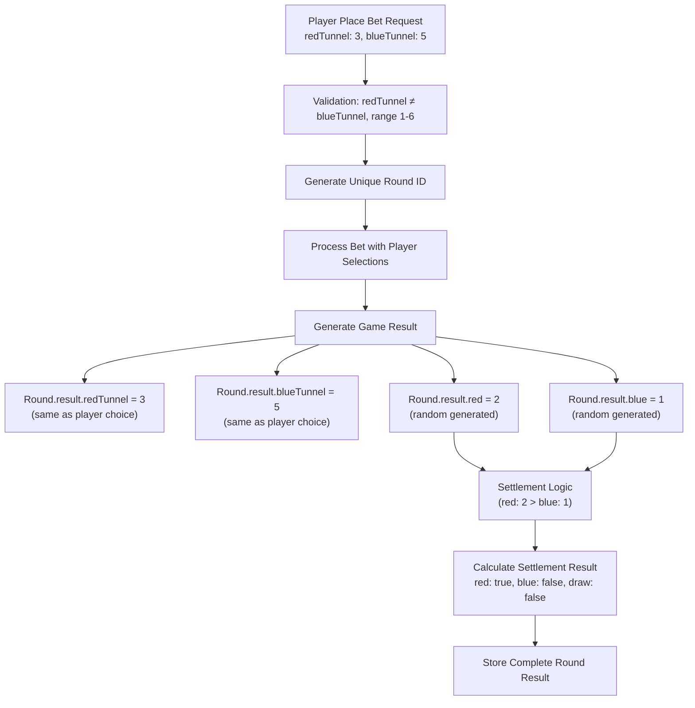

# Tunnel Data Flow - Soccer Pingoal Service

## Data Architecture Overview

This document clarifies the data flow for tunnel selections in the Soccer Pingoal service, specifically addressing how player tunnel choices flow from place bet requests to round storage.

## Key Concepts

### Player Tunnel Selections vs Game Results

**Important**: In this system, the `redTunnel` and `blueTunnel` stored in the round represent **player's specified tunnel choices**, not actual game outcome tunnels.

| Data Type | Location | Purpose | Example |
|-----------|----------|---------|---------|
| **Player Tunnel Selections** | Place Bet Request | What player specified/chose | redTunnel: 3, blueTunnel: 5 |
| **Game Results** | Round.result | Complete game outcome | red: 2, blue: 1, redTunnel: 3, blueTunnel: 5 |

**Note**: The tunnel values in the game results are identical to the player's selections - they are the same data stored in the round.

## Data Flow Diagram



**Important**: The tunnel values (3, 5) flow directly from player request to stored result without any modification. Only the game scores (2, 1) are randomly generated.

## Request to Storage Mapping

### Place Bet Request
```javascript
{
    "betChoice": "blue",
    "amount": 100,
    "redTunnel": 3,      // Player's specified red tunnel choice
    "blueTunnel": 5      // Player's specified blue tunnel choice
}
```

### Round Storage (Database)
```javascript
{
    "id": 8001,
    "result": {
        "red": 2,            // Generated red team score (random game outcome)
        "blue": 1,           // Generated blue team score (random game outcome)  
        "redTunnel": 3,      // Same as player's selection (copied from request)
        "blueTunnel": 5,     // Same as player's selection (copied from request)
        "video": "2-1_3-5_8001.mp4"
    },
    "settlementResult": {
        "blue": false,       // Player bet on blue but red won (2 > 1)
        "red": true,         // Red team won based on scores
        "draw": false        // Not a draw
    },
    "time": "2023-09-17T10:00:00Z",
    "exchangeRateId": 123
}
```

**Key Point**: The `redTunnel: 3, blueTunnel: 5` in the result are **exactly the same** as what the player specified in their bet request. Only the `red` and `blue` scores are randomly generated.

## Implementation Details

### 1. Place Bet Validation (`place-bet-consumer.ts`)

```typescript
validateBetRequestParams(request: any) {
    const { betChoice, amount, redTunnel, blueTunnel } = request;
    
    return [
        // Validate tunnel selections are different
        {
            failure: redTunnel === blueTunnel,
            notice: this.getNoticeObj(helpers.noticeHelper.invalidBet, { 
                message: "redTunnel and blueTunnel cannot be the same" 
            }),
        },
        // Validate tunnel range (1-6)
        {
            failure: redTunnel < 1 || redTunnel > 6 || !Number.isInteger(redTunnel),
            notice: this.getNoticeObj(helpers.noticeHelper.invalidBet, { 
                message: "redTunnel must be an integer between 1 and 6" 
            }),
        },
        // Similar validation for blueTunnel...
    ];
}
```

### 2. Round Creation and Storage

The round result should store the player's tunnel selections:

```typescript
// In round creation logic (needs to be implemented)
const roundResult = {
    red: generateRedScore(),           // Game logic generates final score
    blue: generateBlueScore(),         // Game logic generates final score
    redTunnel: bet.redTunnel,         // Player's selection from place bet
    blueTunnel: bet.blueTunnel,       // Player's selection from place bet
    video: generateVideoUrl(roundId)   // Generated video URL
};
```

### 3. Settlement Logic

Settlement should compare player selections with game results:

```typescript
// Settlement logic (conceptual)
const calculateSettlementResult = (roundResult, betChoice) => {
    // Determine winner based on red vs blue scores
    const winner = roundResult.red > roundResult.blue ? 'red' : 
                  roundResult.blue > roundResult.red ? 'blue' : 'draw';
    
    return {
        red: winner === 'red',
        blue: winner === 'blue', 
        draw: winner === 'draw'
    };
};
```

## Current vs Corrected Understanding

### ❌ Previous Misunderstanding
- Thought `round.result.redTunnel/blueTunnel` were actual game outcome tunnels
- Tried to separate player selections from game results

### ✅ Correct Understanding  
- `round.result.redTunnel/blueTunnel` store **player's tunnel selections** from place bet
- `round.result.red/blue` store **actual game scores** (the real outcome)
- Settlement is based on comparing red vs blue scores, not tunnel selections

## Required Code Updates

### 1. Round Result Population
Need to ensure that when creating a round result, the player's tunnel selections from the bet request are properly stored:

```typescript
// In ProcessBetQueue or settlement logic
const createRoundResult = (bet: BetPayload, gameScores: GameScores) => {
    return {
        red: gameScores.redScore,        // From game engine/logic
        blue: gameScores.blueScore,      // From game engine/logic
        redTunnel: bet.redTunnel,        // From player's bet request
        blueTunnel: bet.blueTunnel,      // From player's bet request
        video: generateVideoUrl(bet.roundId)
    };
};
```

### 2. Settlement Logic Update
Ensure settlement logic uses the correct data:

```typescript
// Settlement based on red vs blue scores, not tunnels
const settleRound = (roundResult: Result) => {
    if (roundResult.red > roundResult.blue) {
        return { red: true, blue: false, draw: false };
    } else if (roundResult.blue > roundResult.red) {
        return { red: false, blue: true, draw: false };
    } else {
        return { red: false, blue: false, draw: true };
    }
};
```

## Data Integrity Checklist

- ✅ Player tunnel selections (1-6) are validated before storage
- ✅ Player tunnel selections are different from each other
- ✅ Round result stores player's original tunnel selections
- ✅ Game scores are generated independently of tunnel selections
- ✅ Settlement logic uses game scores, not tunnel selections
- ✅ Video URL is generated based on round ID

## Summary

The tunnel values (`redTunnel`, `blueTunnel`) in the round result represent **what the player selected** during their bet placement, not the actual game outcome. The actual game outcome is determined by comparing the `red` and `blue` scores in the result object.

This design allows the system to:
1. Store player selections for audit/analysis purposes
2. Generate game results independently 
3. Perform settlement based on score comparison
4. Maintain data integrity and traceability
